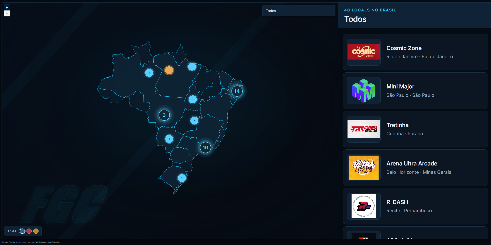

# Viver é lutar, lutar é viver!



## Locals da FGC no Brasil

Mapa comunitário das locals de jogos de luta no Brasil. As posições são aproximadas pelo município informado nas referências.

## Roadmap

- **Versão mobile:** melhorar a experiência em celulares, incluindo navegação pelo mapa e acesso à lista de locais.
- **Links e redes sociais:** adicionar aos locais links para redes sociais, comunidades e outras fontes com mais informações.
- **Mantenedores:** encontrar pessoas da comunidade para ajudar a verificar e atualizar os dados, revisar contribuições e cuidar da evolução do projeto.

As ideias não têm prazo definido. Contribuições e pessoas interessadas em ajudar são bem-vindas.

## Acesso e incorporação

O mapa pode ser incorporado diretamente por uma URL de embed ou dentro de um `iframe`. Use estes parâmetros para configurar a exibição:

| Parâmetro | Valores | Descrição |
| --- | --- | --- |
| `embed` | `1` | Abre o mapa em modo compacto, próprio para incorporação. |
| `theme` | `blue`, `red` ou `yellow` | Define o tema inicial do mapa. |
| `hide` | `theme` | Oculta o seletor de tema. Use junto com `embed=1`; o tema informado em `theme` continua aplicado. |

### URL de embed direto

```text
https://pdrkkf.github.io/fgc-locals/?embed=1&theme=blue&hide=theme
```

### Incorporação via iframe

```html
<iframe
  src="https://pdrkkf.github.io/fgc-locals/?embed=1&theme=red&hide=theme"
  title="Mapa de locals da FGC no Brasil"
  loading="lazy"
  style="width:100%;height:680px;border:0;border-radius:8px"
></iframe>
```

## Como adicionar um local

Os registros ficam no array `places`, em `dist/places.js`. Adicione um objeto ao final, com um ID novo e um `imageSlug` que corresponda ao nome do arquivo da logo.

```js
{
  id: 41,
  name: 'Nova Local',
  city: 'Belo Horizonte',
  state: 'MG',
  sourcePart: 1,
  lat: -19.9167,
  lng: -43.9345,
  imageSlug: 'nova-local'
}
```

Use o município indicado pela referência e coordenadas aproximadas desse município. Latitude sul e longitude oeste são negativas. Se a abrangência ou localização ainda não estiver confirmada, preserve o nome disponível e registre `locationScope: 'unverified'`; não presuma que seja uma capital. `source` e `verifiedAt` podem ser incluídos quando houver uma fonte e uma data de verificação confiáveis.

### Logo do local

Salve a logo em WebP, com **480 × 360 px**, em `dist/assets/poi-images/`. Recorte margens excessivas e use transparência quando combinar com a imagem. Para o exemplo, o arquivo será `poi-41-nova-local.webp`. O slug em `imageSlug` associa a imagem diretamente ao registro, sem depender da posição no array.

`dist/assets/poi-images/manifest.json` cataloga as imagens e suas origens; atualize a entrada correspondente quando adicionar uma logo. Registre a origem real do material e os limites do recorte quando conhecidos.

Cada registro mantém o campo `sourcePart` para a referência de origem disponível no projeto. Não invente links, datas de verificação nem fontes ausentes.

## Estrutura principal

```text
dist/
├── index.html                   # Interface e carregamento de recursos
├── styles.css                   # Temas e estilos responsivos
├── app.js                       # Mapa, interação, filtros e marcadores
├── places.js                    # Registros dos locais
├── clustering.js                # Agrupamento de pontos em pixels
├── states.geojson               # Limites estaduais usados pelo mapa
└── assets/poi-images/
    ├── manifest.json            # Índice, dimensões e origem das logos
    └── poi-*.webp               # Logos dos locais
.github/workflows/pages.yml      # Publicação automática no GitHub Pages
LICENSE                          # Licença MIT do código e da documentação
THIRD_PARTY_NOTICES.md           # Aviso e licença da biblioteca Leaflet
test/clustering.test.js          # Testes do agrupamento de marcadores
```

Execute os testes do agrupamento com `node --test`.

## Créditos e dependências

Mapa mantido pela comunidade. Créditos: Kinomoto / Odakechi / CarolTheQueen / [Karkaroff](https://github.com/pdrkkf/fgc-locals).

O mapa usa [Leaflet 1.9.4](https://leafletjs.com/) para a interface cartográfica, carregado pelo CDN unpkg sob a licença BSD 2-Clause. O aviso de direitos autorais e o texto da licença estão em [`THIRD_PARTY_NOTICES.md`](THIRD_PARTY_NOTICES.md).

### Aviso sobre logos e marcas

As logos, marcas e demais imagens exibidas pertencem aos seus respectivos donos, que mantêm todos os direitos sobre esses materiais. Elas são usadas no mapa apenas para identificar os locais. A licença MIT deste projeto não concede autorização para copiar, modificar ou redistribuir essas logos e marcas; consulte os titulares para obter permissão de uso. O arquivo `dist/states.geojson` não contém metadados de origem ou licença, e o histórico Git disponível não identifica a fonte cartográfica. A procedência e as condições de redistribuição dos limites permanecem não verificadas.

## Licença

O código e a documentação deste projeto são distribuídos sob a licença **MIT**. O uso e as alterações são gratuitos; você pode copiar, modificar e redistribuir esse material, mantendo o aviso de copyright e o texto da licença. Consulte [`LICENSE`](LICENSE). A licença MIT não cobre as logos, marcas ou outros materiais de terceiros descritos acima.
